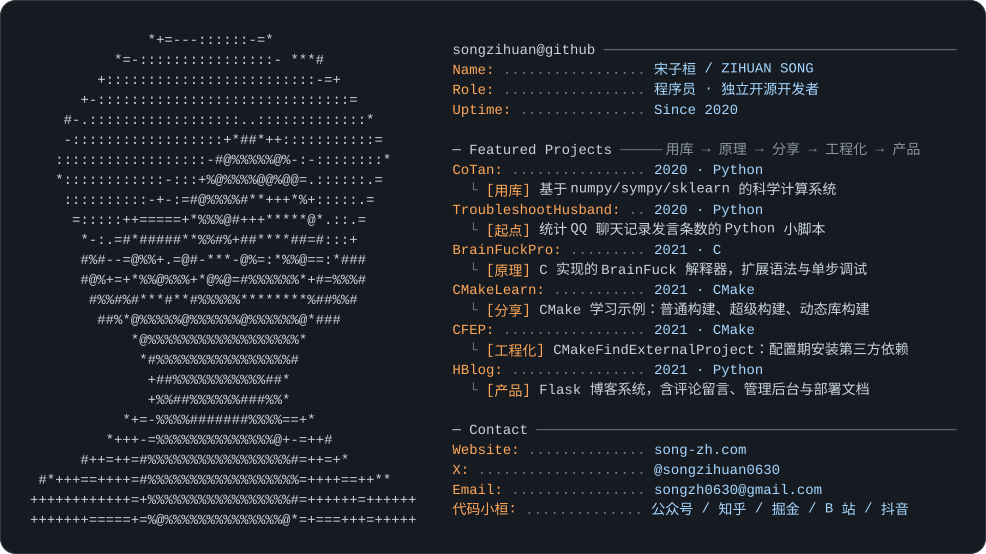

<picture>
  <source media="(prefers-color-scheme: dark)" srcset="dark_mode.svg">
  <source media="(prefers-color-scheme: light)" srcset="light_mode.svg">
  
</picture>

你好，我是宋子桓。从 2020 年开始写代码，现在是一名独立开源开发者。个人站点：[song-zh.com](https://song-zh.com)
